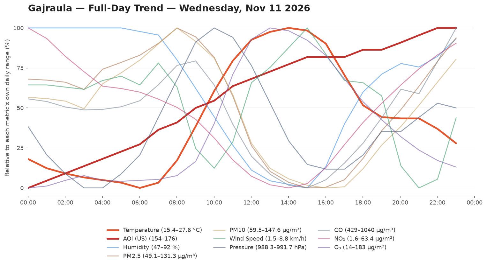

# 🌦️ Weather & AQI Logger

Automated Weather Logger. Logs Temperature,Humidity,Wind speed, Pressure and Air Quality Every Hour.

- **Data source:** [Open-Meteo](https://open-meteo.com/)
- **Update frequency:** every hour, via .[cron-job](https://cron-job.org/)
- **Raw data:** [`data/weather_log.csv`](data/weather_log.csv)

## 📊 Current Conditions

<!-- DATA-START -->
**Last updated:** `2026-11-12 14:30:34 UTC`

| Metric | Value |
|---|---|
| 🌡️ Temperature | 21.8 °C |
| 💧 Humidity | 80 % |
| 🌧️ Rain (last hr) | 0.0 mm |
| 💨 Wind Speed | 4.5 km/h |
| 🧭 Wind Direction | 37° |
| 🔵 Pressure | 991.3 hPa |
| 🌫️ AQI (US) | 204 — Very Unhealthy 🟣 |
| PM2.5 | 144.8 µg/m³ |
| PM10 | 164.4 µg/m³ |

<details><summary>Last 24 readings</summary>

| Time (UTC) | Temp °C | Rain mm | AQI | Wind km/h | Humidity % |
|---|---|---|---|---|---|
| 2026-11-12 14:30:34 | 21.8 | 0.0 | 204 | 4.5 | 80 |
| 2026-11-12 13:30:35 | 22.3 | 0.0 | 202 | 4.7 | 77 |
| 2026-11-12 12:30:35 | 23.2 | 0.0 | 200 | 5.4 | 74 |
| 2026-11-12 11:30:33 | 24.9 | 0.0 | 199 | 2.3 | 71 |
| 2026-11-12 10:30:37 | 26.7 | 0.0 | 198 | 4.3 | 59 |
| 2026-11-12 09:30:35 | 27.4 | 0.0 | 194 | 5.7 | 49 |
| 2026-11-12 08:30:33 | 27.5 | 0.0 | 193 | 4.3 | 49 |
| 2026-11-12 07:30:32 | 27.1 | 0.0 | 193 | 2.8 | 51 |
| 2026-11-12 06:30:34 | 26.3 | 0.0 | 191 | 1.3 | 56 |
| 2026-11-12 05:30:34 | 25.2 | 0.0 | 190 | 1.7 | 63 |
| 2026-11-12 04:30:33 | 23.4 | 0.0 | 189 | 0.0 | 69 |
| 2026-11-12 03:30:36 | 21.2 | 0.0 | 188 | 1.6 | 77 |
| 2026-11-12 02:30:34 | 18.7 | 0.0 | 187 | 3.7 | 85 |
| 2026-11-12 01:30:38 | 16.8 | 0.0 | 185 | 5.8 | 91 |
| 2026-11-12 00:30:29 | 16.5 | 0.0 | 184 | 5.5 | 92 |
| 2026-11-11 23:30:36 | 16.8 | 0.0 | 183 | 5.6 | 91 |
| 2026-11-11 22:30:34 | 17.1 | 0.0 | 182 | 5.9 | 92 |
| 2026-11-11 19:30:37 | 18.2 | 0.0 | 178 | 5.6 | 88 |
| 2026-11-11 18:30:42 | 18.4 | 0.0 | 177 | 5.3 | 89 |
| 2026-11-11 17:30:36 | 18.8 | 0.0 | 176 | 4.7 | 89 |
| 2026-11-11 16:30:41 | 19.9 | 0.0 | 176 | 1.9 | 84 |
| 2026-11-11 15:30:39 | 20.7 | 0.0 | 175 | 1.5 | 81 |
| 2026-11-11 14:32:44 | 20.7 | 0.0 | 174 | 2.5 | 82 |
| 2026-11-11 13:30:33 | 20.8 | 0.0 | 173 | 5.7 | 79 |

</details>
<!-- DATA-END -->

## 📈 Full-Day Trend

Every logged metric for yesterday (the last fully completed day, midnight-to-midnight IST), normalized to its own range so temperature, AQI, humidity, and the rest can be compared by shape on one chart. Only changes once a day, when a new day rolls over.


## 🗂️ Chart History

Every day's full-day trend chart, newest first. No retention limit — this grows forever.

<!-- HISTORY-START -->
<details><summary>Last 97 day(s)</summary>

**2026-11-11**


**2026-11-10**


**2026-11-09**


**2026-11-08**


**2026-11-07**


**2026-11-06**


**2026-11-05**


**2026-11-04**


**2026-11-03**


**2026-11-02**


**2026-11-01**


**2026-10-31**


**2026-10-30**


**2026-10-29**


**2026-10-28**


**2026-10-27**


**2026-10-26**


**2026-10-25**


**2026-10-24**


**2026-10-23**


**2026-10-22**


**2026-10-21**


**2026-10-20**


**2026-10-19**


**2026-10-18**


**2026-10-17**


**2026-10-16**


**2026-10-15**


**2026-10-14**


**2026-10-13**


**2026-10-12**


**2026-10-11**


**2026-10-10**


**2026-10-09**


**2026-10-08**


**2026-10-07**


**2026-10-06**


**2026-10-05**


**2026-10-04**


**2026-10-03**


**2026-10-02**


**2026-10-01**


**2026-09-30**


**2026-09-29**


**2026-09-28**


**2026-09-27**


**2026-09-26**


**2026-09-25**


**2026-09-24**


**2026-09-23**


**2026-09-22**


**2026-09-21**


**2026-09-20**


**2026-09-19**


**2026-09-18**


**2026-09-17**


**2026-09-16**


**2026-09-15**


**2026-09-14**


**2026-09-13**


**2026-09-12**


**2026-09-11**


**2026-09-10**


**2026-09-09**


**2026-09-08**


**2026-09-07**


**2026-09-06**


**2026-09-05**


**2026-09-04**


**2026-09-03**


**2026-09-02**


**2026-09-01**


**2026-08-31**


**2026-08-30**


**2026-08-29**


**2026-08-28**


**2026-08-27**


**2026-08-26**


**2026-08-25**


**2026-08-24**


**2026-08-23**


**2026-08-22**


**2026-08-21**


**2026-08-20**


**2026-08-19**


**2026-08-18**


**2026-08-17**


**2026-08-16**


**2026-08-15**


**2026-08-14**


**2026-08-13**


**2026-08-12**


**2026-08-11**


**2026-08-10**


**2026-08-09**


**2026-08-08**


**2026-08-07**


</details>
<!-- HISTORY-END -->

## 📁 Repo structure

```
weather-logger/
├── .github/workflows/update-weather.yml
├── data/weather_log.csv
├── data/day_chart.png
├── data/chart-history/        # every day, unlimited, e.g. 2026-08-08.png
├── scripts/fetch_weather.py
├── scripts/update_readme.py
├── scripts/generate_chart.py
├── scripts/backfill_chart_history.py
├── README.md
└── requirements.txt
```
